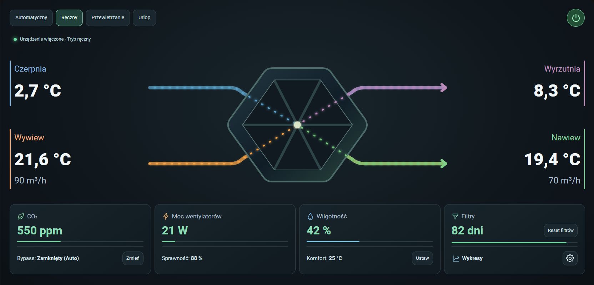
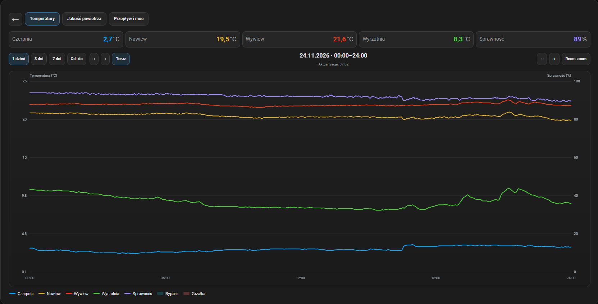
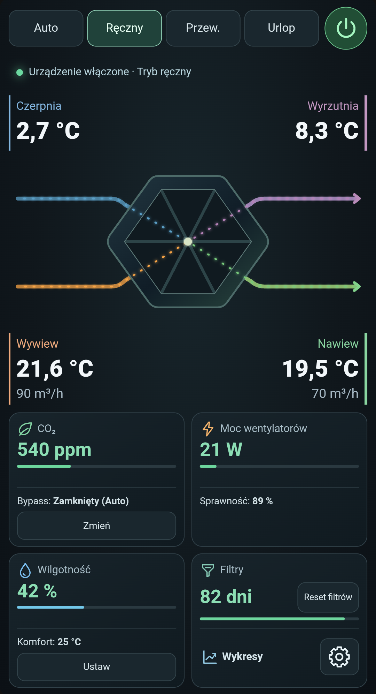
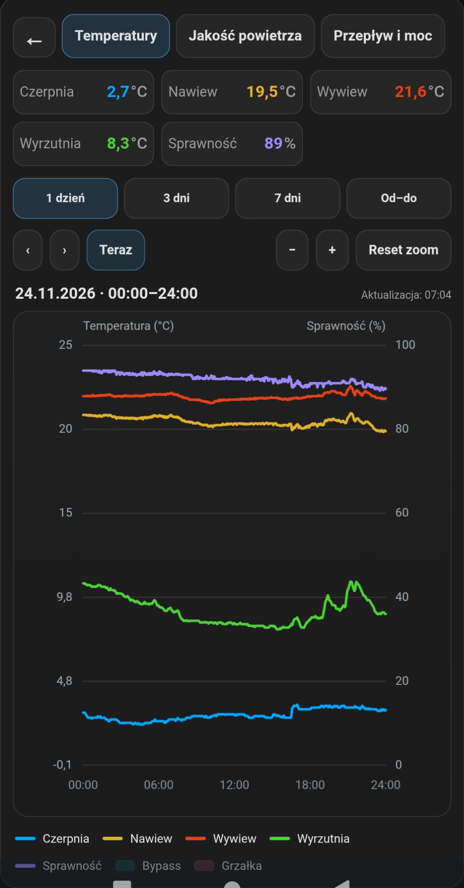

[Polski](README.md) · **English**

# Rekuperator reQ


Monitor and control your REQNET heat recovery ventilation unit directly in Home Assistant. Temperatures, air quality, ventilation settings and history charts in one place, using local MQTT.

**Independence:** the project is not created, sponsored, endorsed or officially supported by the REQNET device manufacturer. Manufacturer trade names are used solely to identify the protocol and compatibility.

[](https://my.home-assistant.io/redirect/marketplace_repository/?owner=siwekpio&repository=req-rekuperator&category=integration)

## Features

- Temperatures, airflow, humidity and CO₂ (where provided by the device).
- Operating modes, airing, bypass and comfort temperature control.
- Fan power, calculated heat recovery efficiency and filter information.
- Dedicated control panel and three Recorder history charts.
- MQTT diagnostics and optional local API device information.

## Screenshots

Actual readings from the maintainer's ventilation unit on PC and Android. Click an image to enlarge it.

| PC — panel | PC — wykresy / charts |
|---|---|
| [](screenshots/panel_pc.png) | [](screenshots/wykresy_pc.png) |

| Android — panel | Android — wykresy / charts |
|---|---|
| <a href="screenshots/panel_android.png"></a> | <a href="screenshots/wykresy_android.png"></a> |

## Requirements

- Home Assistant Core **2026.11.2 or newer** (declared minimum, not a complete test matrix).
- REQNET Wi-Fi module and a working MQTT broker reachable on the local network.
- Readings verified on a device reporting technical `DeviceType=6`, firmware 9.25 and Wi-Fi API 113. Full model compatibility is not established. DeviceType is not a commercial model name.

## Installation step by step

### 1. Set up MQTT in Home Assistant

Use your existing broker if MQTT already works. On HAOS you can install and start Mosquitto Broker from the app catalog. Add the standard MQTT integration under **Settings → Devices & services**. Create a dedicated MQTT account for the ventilation unit, not an administrator account. Note the broker IP, port (typically 1883 without TLS), username and password. [MQTT help](https://www.home-assistant.io/integrations/mqtt/).

### 2. Connect the ventilation unit to the broker

If the unit already sends data to the same MQTT broker, **skip this step**. The REQNET module is an MQTT client; the broker runs e.g. in Home Assistant, not inside the unit.

**Setup in a web browser** (no additional software)

1. Find the ventilation unit's local Wi-Fi module IP address (e.g. in your router).
2. Copy the address below into a local text editor and replace the example values with your own. Do not send the request yet.

```text
http://192.168.7.1/API/RunFunction?name=ChangeAdditionalBrokerConfiguration&MQTT_ADDITIONAL_BROKER_ADDRESS=192.168.1.100&MQTT_ADDITIONAL_BROKER_PORT=1883&MQTT_ADDITIONAL_BROKER_USER=req_mqtt&MQTT_ADDITIONAL_BROKER_PASSWORD=your_password
```

| Example value | Replace with your own details |
|---|---|
| `192.168.7.1` | Ventilation unit's Wi-Fi module IP address |
| `192.168.1.100` | MQTT broker IP reachable from the unit (not `localhost`) |
| `1883` | MQTT broker port |
| `req_mqtt` | MQTT username |
| `your_password` | MQTT password |

**Important:** use only a trusted LAN and dedicated MQTT credentials. The manufacturer's API sends the password in an unencrypted HTTP URL parameter. The address may remain in browser history, the clipboard or device/network logs. Private browsing reduces history retention but does not encrypt the connection. Never share the URL or credentials. Special characters in the username and password require URL encoding (e.g. `&` → `%26`, `+` → `%2B`, `#` → `%23`, `%` → `%25`, space → `%20`). If unsure, use the optional helper below; do not paste passwords into online URL encoders.

3. Check your details. Paste the prepared address into the browser's address bar and press Enter **only once**. This changes the additional MQTT connection settings; do not refresh the page to retry the request.

**Verify the configuration**

Example of a successful API response:

```json
{
  "ChangeAdditionalBrokerConfigurationResult": true,
  "Message": ""
}
```

A value of `true` means the API reported successful configuration. Check the broker logs and whether the unit connected; after installing the integration, check actual readings. The API response alone does not guarantee MQTT connectivity. If the result is uncertain, check the device rather than automatically retrying.

**Alternative — Python setup helper (optional)**

Download and extract the manual installation package from [Releases](https://github.com/siwekpio/req-rekuperator/releases). On a computer with Python 3, run `python tools/configure_mqtt.py` from the extracted directory (Windows: `py -3 tools/configure_mqtt.py`, Linux/macOS: `python3 tools/configure_mqtt.py`). The helper hides password input, encodes the parameters and sends the request only after you enter `TAK` (yes). Enter `NIE` (no) to exit without sending. HTTP remains unencrypted.

[More about MQTT setup and the optional helper](docs/MQTT.en.md).

### 3. Install the integration

Make a full Home Assistant backup before installation.

**Marketplace — recommended method**

1. Use the My Home Assistant button above or open **Settings → Marketplace**.
2. Search for **Rekuperator reQ**. If it is not listed, choose **Add from link** and enter `https://github.com/siwekpio/req-rekuperator`. If prompted for the type, select **Integration**. Connect GitHub when Home Assistant asks you to do so for a custom repository.
3. Open Rekuperator reQ, select **Install**, choose the available stable release and confirm. Restart Home Assistant.

A separate HACS installation is not needed on Home Assistant 2026.11. This is a community project, not officially reviewed or supported by Home Assistant. [Marketplace documentation](https://www.home-assistant.io/integrations/marketplace/).

**Alternative — manual installation**

Download and extract the manual installation archive from [Releases](https://github.com/siwekpio/req-rekuperator/releases) if you have not already done so. Copy the entire `custom_components/req_rekuperator` directory to `/config/custom_components/req_rekuperator` and restart Home Assistant. Choose one installation method; do not mix files from different versions.

**Configure the integration (both methods)**

Open **Settings → Devices & services → Add integration**, search for **Rekuperator reQ** and enter the module's private IPv4 address or MAC. MAC alone is supported if local HTTP is unavailable. Check that entities show actual readings. If the integration is already configured, keep existing entries; do not add the devices again.

### 4. Add the panel and charts

Enable advanced mode in your HA profile if Resources is hidden. Under **Settings → Dashboards → Resources**, add a **JavaScript module** resource:

```text
/req-rekuperator/rekuperator-js.js?v=0114
```

For YAML-managed resources, add the same URL to the existing resource configuration. Do not create duplicates.

Create a dashboard with two views (Control and Charts). Use [examples/dashboard.yaml](examples/dashboard.yaml) in the dashboard YAML editor; do not overwrite an existing dashboard without a backup. Cards are `custom:req-rekuperator-card` and `custom:req-rekuperator-charts`. For multiple devices set the correct config `entry_id` in both cards. Recorder must record the relevant entities for charts to have history.

## Updating and troubleshooting

Back up HA. For Marketplace-managed installations, use **Settings → Updates**; for manual installations, replace the entire component directory. Restart HA and update the existing JavaScript resource. Keep integration entries and history. [Update and rollback instructions](docs/INSTALLATION.en.md).

- **No readings?** Check the broker, MQTT credentials, module MAC and HA logs.
- **No charts?** Check Recorder, time range and the correct device entry.
- **Missing DeviceType?** It is an HTTP diagnostic code, not a model name. It may be unavailable with MAC-only setup.
- **Uncertain command result?** Check the actual device. Do not retry automatically or control from multiple instances at once.

Not all models, firmware and commands have been separately verified. Help improve compatibility by [reporting your model](docs/ZGLOSZENIE_MODELU.md) (Polish template; English reports welcome). Never share IP/MAC addresses, serial numbers, passwords or tokens.

## Support and license

[Issues and suggestions](https://github.com/siwekpio/req-rekuperator/issues) · [Security](SECURITY.md) · [Changelog](CHANGELOG.md) · [REQNET protocol](docs/PROTOCÓŁ_REQNET.md) (Polish)

Code and original documentation: [GNU GPL v3 (GPL-3.0-only)](LICENSE). Artwork and name: [separate terms](BRANDING.en.md). [License scope](LICENSING.md).
