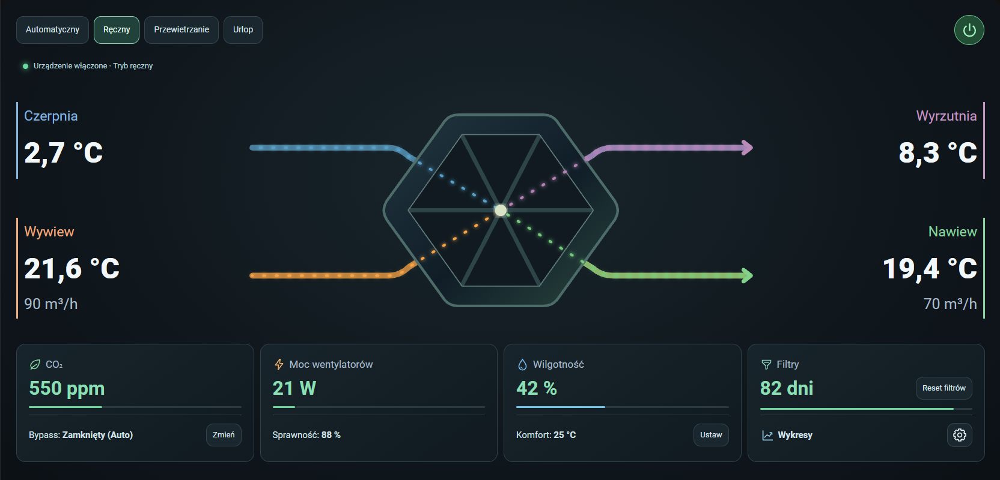
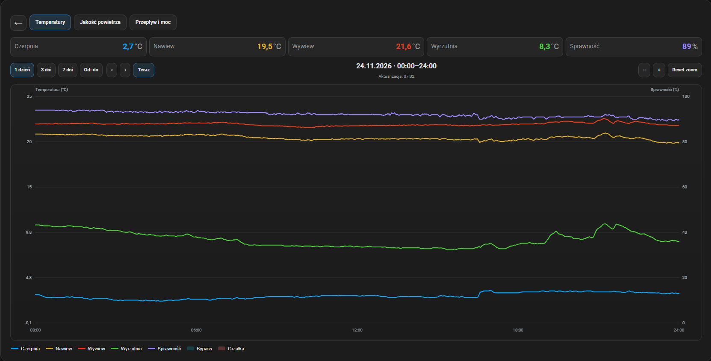
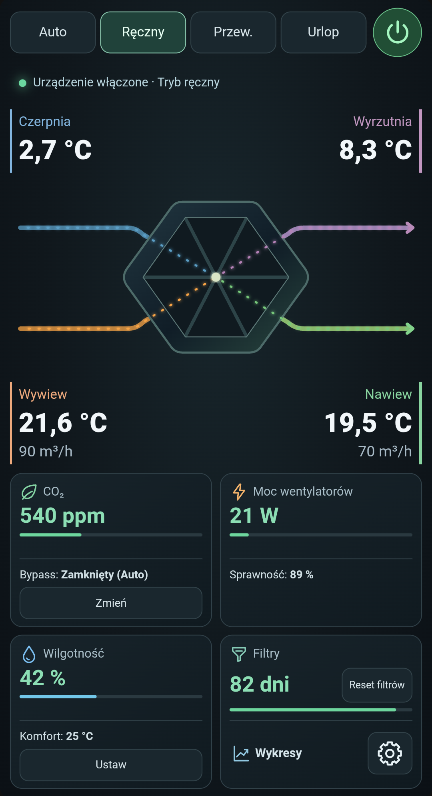
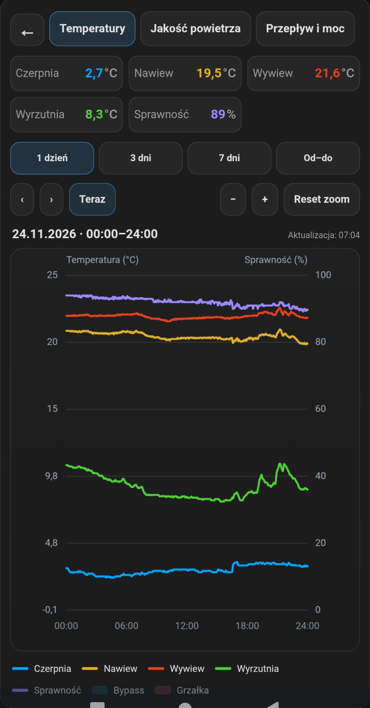

**Polski** · [English](README.en.md)

# Rekuperator reQ


Monitoruj i steruj swoim rekuperatorem REQNET bezpośrednio z Home Assistant. Temperatury, jakość powietrza, ustawienia wentylacji i wykresy historii w jednym miejscu — przez lokalne połączenie MQTT.

**Niezależność:** projekt nie jest tworzony, sponsorowany, zatwierdzony ani oficjalnie wspierany przez producenta urządzeń REQNET. Nazwy handlowe producenta służą wyłącznie wskazaniu protokołu i kompatybilności.

[](https://my.home-assistant.io/redirect/marketplace_repository/?owner=siwekpio&repository=req-rekuperator&category=integration)

## Co oferuje integracja?

- Podgląd temperatur, przepływów powietrza, wilgotności i CO₂ (jeśli urządzenie udostępnia te dane).
- Sterowanie trybami pracy, przewietrzaniem, bypassem i temperaturą komfortu.
- Moc wentylatorów, obliczana sprawność odzysku ciepła i informacje o filtrach.
- Własny panel sterowania oraz trzy wykresy historii z Recorder.
- Diagnostyka MQTT i opcjonalne informacje o urządzeniu z lokalnego API.

## Zobacz, jak wygląda

Rzeczywiste odczyty z rekuperatora autora — komputer i Android. Kliknij obraz, aby go powiększyć.

| PC — panel | PC — wykresy / charts |
|---|---|
| [](screenshots/panel_pc.png) | [](screenshots/wykresy_pc.png) |

| Android — panel | Android — wykresy / charts |
|---|---|
| <a href="screenshots/panel_android.png"></a> | <a href="screenshots/wykresy_android.png"></a> |

## Wymagania

- Home Assistant Core **2026.11.2 lub nowszy** (zadeklarowane minimum, nie pełna matryca testów).
- Moduł Wi-Fi REQNET oraz działający broker MQTT dostępny w sieci lokalnej.
- Potwierdzono odczyty urządzenia o technicznym typie `DeviceType=6`, firmware 9.25, API Wi-Fi 113. Nie ustalono pełnej listy zgodnych modeli. Typ urządzenia nie jest nazwą handlową.

## Instalacja krok po kroku

### 1. Przygotuj MQTT w Home Assistant

Jeżeli MQTT już działa, użyj swojego brokera. W HAOS możesz zainstalować i uruchomić Mosquitto Broker z katalogu aplikacji. Dodaj standardową integrację MQTT w **Ustawienia → Urządzenia i usługi**. Przygotuj osobne konto MQTT dla rekuperatora (nie konto administratora). Zapisz adres IP brokera, port (zwykle 1883 bez TLS), użytkownika i hasło. [Pomoc MQTT](https://www.home-assistant.io/integrations/mqtt/).

### 2. Połącz rekuperator z brokerem

Jeżeli rekuperator już przesyła dane do tego samego brokera MQTT, **pomiń ten krok**. Moduł REQNET jest klientem MQTT — broker działa np. w Home Assistant, a nie w centrali.

**Konfiguracja przez przeglądarkę internetową** (bez dodatkowych programów)

1. Znajdź adres IP modułu Wi-Fi rekuperatora w sieci lokalnej (np. w routerze).
2. Skopiuj poniższy adres do lokalnego edytora tekstu i zastąp przykładowe wartości własnymi. Nie wysyłaj jeszcze żądania.

```text
http://192.168.7.1/API/RunFunction?name=ChangeAdditionalBrokerConfiguration&MQTT_ADDITIONAL_BROKER_ADDRESS=192.168.1.100&MQTT_ADDITIONAL_BROKER_PORT=1883&MQTT_ADDITIONAL_BROKER_USER=req_mqtt&MQTT_ADDITIONAL_BROKER_PASSWORD=twoje_haslo
```

| Przykładowa wartość | Zastąp własnymi danymi |
|---|---|
| `192.168.7.1` | Adres IP rekuperatora (modułu Wi-Fi) |
| `192.168.1.100` | Adres IP brokera MQTT dostępny z rekuperatora (nie `localhost`) |
| `1883` | Port brokera MQTT |
| `req_mqtt` | Nazwa użytkownika MQTT |
| `twoje_haslo` | Hasło użytkownika MQTT |

**Ważne:** używaj wyłącznie zaufanej sieci lokalnej i osobnego konta MQTT. API producenta przesyła hasło w adresie URL przez nieszyfrowany HTTP. Adres może pozostać w historii przeglądarki, schowku lub logach urządzenia/sieci. Tryb prywatny ogranicza zapisywanie historii, ale nie szyfruje połączenia. Nie udostępniaj adresu ani danych logowania. Znaki specjalne w nazwie użytkownika i haśle wymagają kodowania URL (np. `&` → `%26`, `+` → `%2B`, `#` → `%23`, `%` → `%25`, spacja → `%20`). Jeśli nie wiesz, jak je zakodować, użyj opcjonalnego konfiguratora poniżej; nie wklejaj haseł do internetowych koderów URL.

3. Sprawdź dane. Wklej przygotowany adres do paska adresu przeglądarki i naciśnij Enter **tylko raz**. To zmienia ustawienia dodatkowego połączenia MQTT; nie odświeżaj strony w celu ponowienia żądania.

**Weryfikacja konfiguracji**

Przykładowa prawidłowa odpowiedź API:

```json
{
  "ChangeAdditionalBrokerConfigurationResult": true,
  "Message": ""
}
```

Wartość `true` oznacza, że API zgłosiło pomyślne wykonanie konfiguracji. Sprawdź następnie logi brokera i czy rekuperator się połączył; po instalacji integracji sprawdź rzeczywiste odczyty. Sama odpowiedź API nie gwarantuje połączenia MQTT. Jeśli wynik jest niepewny, sprawdź stan urządzenia, nie ponawiaj automatycznie.

**Alternatywa — konfigurator Python (opcjonalnie)**

Pobierz i rozpakuj paczkę instalacyjną z [Releases](https://github.com/siwekpio/req-rekuperator/releases). Na komputerze z Pythonem 3 uruchom z jej katalogu `python tools/configure_mqtt.py` (Windows: `py -3 tools/configure_mqtt.py`, Linux/macOS: `python3 tools/configure_mqtt.py`). Konfigurator ukrywa wpisywane hasło, koduje parametry i wysyła żądanie dopiero po wpisaniu `TAK`. Wpisz `NIE`, aby zakończyć bez wysyłania. Połączenie HTTP nadal nie jest szyfrowane.

[Więcej o konfiguracji MQTT i opcjonalnym narzędziu](docs/PIERWSZA_KONFIGURACJA_MQTT.md).

### 3. Zainstaluj integrację

Wykonaj pełną kopię zapasową Home Assistant przed instalacją.

**Marketplace (Katalog społeczności) — metoda zalecana**

1. Kliknij przycisk My Home Assistant powyżej lub otwórz **Ustawienia → Marketplace** (Katalog społeczności).
2. Wyszukaj **Rekuperator reQ**. Jeśli nie ma jej w katalogu, wybierz **Dodaj z linku** i wpisz `https://github.com/siwekpio/req-rekuperator`. Jeżeli pojawi się wybór typu, wybierz **Integracja**. Przy dodawaniu własnego repozytorium połącz konto GitHub zgodnie z komunikatami HA.
3. Otwórz stronę Rekuperator reQ, kliknij **Zainstaluj**, wybierz dostępne stabilne wydanie i potwierdź. Uruchom ponownie Home Assistant.

Nie trzeba instalować osobnego HACS w Home Assistant 2026.11. Integracja jest projektem społecznościowym, nie jest oficjalnie weryfikowana ani wspierana przez Home Assistant. [Dokumentacja Marketplace](https://www.home-assistant.io/integrations/marketplace/).

**Alternatywa — instalacja ręczna**

Pobierz i rozpakuj paczkę instalacyjną z [Releases](https://github.com/siwekpio/req-rekuperator/releases), jeśli jeszcze tego nie zrobiłeś. Skopiuj cały folder `custom_components/req_rekuperator` do `/config/custom_components/req_rekuperator` i uruchom ponownie Home Assistant. Wybierz jedną metodę instalacji, nie mieszaj plików różnych wersji.

**Konfiguracja integracji (obie metody)**

Otwórz **Ustawienia → Urządzenia i usługi → Dodaj integrację**, wyszukaj **Rekuperator reQ** i podaj prywatny adres IPv4 modułu lub jego MAC. Możesz podać sam MAC, jeśli lokalne HTTP nie działa. Sprawdź, czy encje pokazują rzeczywiste odczyty. Jeżeli integracja jest już skonfigurowana, zachowaj istniejące wpisy — nie dodawaj urządzeń ponownie.

### 4. Dodaj panel i wykresy

Włącz tryb zaawansowany w profilu HA, jeśli opcja zasobów nie jest widoczna. W **Ustawienia → Panele → Zasoby** dodaj zasób typu **Moduł JavaScript**:

```text
/req-rekuperator/rekuperator-js.js?v=0113
```

Jeżeli zasoby są zarządzane w YAML, dodaj ten sam URL do istniejącej konfiguracji zasobów. Nie twórz duplikatów.

Utwórz panel z dwiema zakładkami (Sterowanie i Wykresy). W edytorze YAML panelu użyj przykładu [examples/dashboard.yaml](examples/dashboard.yaml). Nie nadpisuj istniejącego panelu bez kopii. Karty to `custom:req-rekuperator-card` i `custom:req-rekuperator-charts`. Przy kilku urządzeniach ustaw `entry_id` odpowiedniego wpisu w obu kartach. Recorder musi rejestrować odpowiednie encje, aby wykresy miały historię.

## Aktualizacja i rozwiązywanie problemów

Zrób backup. Jeśli integracją zarządza Marketplace, wybierz aktualizację w **Ustawienia → Aktualizacje**; w instalacji ręcznej podmień cały katalog integracji. Uruchom HA ponownie i zaktualizuj istniejący zasób JavaScript. Nie usuwaj wpisów integracji ani historii. [Aktualizacja i powrót do poprzedniej wersji](docs/INSTALACJA_I_AKTUALIZACJA.md).

- **Brak odczytów?** Sprawdź broker, konto MQTT, adres MAC modułu i logi HA.
- **Brak wykresów?** Sprawdź Recorder, zakres czasu i właściwy wpis urządzenia.
- **Brak typu urządzenia?** To odczyt diagnostyczny HTTP, nie nazwa modelu. Przy samym MAC może być niedostępny.
- **Niepewny wynik polecenia?** Sprawdź stan centrali. Nie ponawiaj automatycznie. Nie steruj jednocześnie z kilku instancji.

Nie wszystkie modele, wersje firmware i polecenia zostały osobno zweryfikowane. Jeśli chcesz pomóc w rozwoju zgodności, [zgłoś model](docs/ZGLOSZENIE_MODELU.md). Nie udostępniaj IP, MAC, numerów seryjnych, haseł ani tokenów.

## Wsparcie i licencja

[Błędy i propozycje](https://github.com/siwekpio/req-rekuperator/issues) · [Bezpieczeństwo](SECURITY.md) · [Historia zmian](CHANGELOG.md) · [Protokół REQNET](docs/PROTOCÓŁ_REQNET.md)

Kod i własna dokumentacja: [GNU GPL v3 (GPL-3.0-only)](LICENSE). Grafiki i nazwa: [osobne zasady](BRANDING.md). [Zakres licencji](LICENSING.md).
